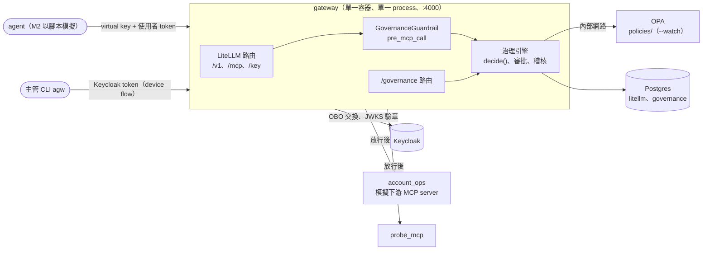

# AI Governance Gateway

統一治理 agent 的 LLM 流量與 tool 呼叫：agent 身份、委託授權、policy 判斷、人工審批與稽核。
以 LiteLLM 作為 LLM 與 MCP 的 data plane，Keycloak 作為 IdP，OPA 作為 policy 引擎；治理邏輯只補 LiteLLM 開源版做不到的部分。

## 現況

| 階段 | 內容 | 狀態 |
| ---- | ---- | ---- |
| M1 | 技術驗證：LiteLLM（LLM + MCP gateway）、Keycloak、OBO | 完成，結果見 [m1-findings.md](docs/spikes/m1-findings.md) |
| M2 | 治理服務：OPA policy、agent 版本 key、maker-checker 審批、hash chain 稽核 | 完成：端到端 13/13、單元測試 141、整合測試 14、Rego 測試 33 |
| M3 | kyt_agent 接入高風險 tool | 未開始 |

## 架構



- gateway 以 LiteLLM 原本的 `litellm --config` 啟動；LiteLLM 依 `litellm/config.yaml` 的 guardrail 設定載入 `ai_gov_gateway.plugin`，該模組在載入時把 `/governance` 路由掛到 LiteLLM 的 app，所以治理與 LiteLLM 在同一個 process、同一個 port
- 治理引擎（`src/ai_gov_gateway/engine/`）不 import LiteLLM，依賴 `PolicyClient`（OPA）與 `GovernanceStore`（Postgres）兩個 Protocol
- agent 的版本綁在 virtual key 上：key 命名為 `<agent>@<版本>`，一個核准版本一把 key
- 一律 fail-closed：token 無效、OPA 無法回應、資料庫或稽核寫入失敗時都拒絕

### 決策流程

1. 驗證使用者 token（JWKS、issuer、audience、到期時間）；`azp` 必須在 `GOV_OIDC_ALLOWED_CLIENTS`（JSON 陣列，預設 `["kyt-cli", "agw-cli"]`）內，服務帳號的 client_credentials token 不能當成委託人
2. 解析 `key_alias`，組成 OPA input（agent、user、tool、arguments），每次都先問 OPA
3. OPA 回 `allow` / `deny` / `require_approval`
4. `require_approval` 時，以 fingerprint（agent 版本、委託人、tool、參數）找已核准、未使用、未過期的審批：本次 policy 的原因都已在核准範圍內就兌現一次並放行（出現新原因時作廢舊審批、重新送審），沒有就建立或沿用 pending 審批，回傳 `approval_id`
5. 每個決策都寫入 hash chain 稽核

被拒絕或待審批時，client 的 tool result 為 `isError=True`，內容是 JSON：

```json
{"governance": "pending_approval", "approval_id": "apr_…", "reasons": ["amount_over_threshold"], "expires_at": "…"}
{"governance": "denied", "reasons": ["role_required"]}
```

M1 的主要結論：

| 能力 | 由誰提供 |
| ---- | -------- |
| 模型別名、rpm、預算、依 key 計費 | LiteLLM 開源版 |
| MCP tool 權限、tool 定義鎖定、對上游的 OBO | LiteLLM 開源版（tool 鎖定需 v1.105.1 以上） |
| 依參數值的 policy、maker-checker 審批、防竄改稽核 | 自建（M2），以 LiteLLM hook 為執行點 |

## 服務

| 服務 | Port | 用途 |
| ---- | ---- | ---- |
| `gateway` | 4000 | LiteLLM v1.105.1 加上治理套件：LLM 與 MCP gateway、`/governance` 路由 |
| `postgres` | `127.0.0.1:55433` | 資料庫 `litellm`（virtual key 與用量）、`governance`（審批與稽核，gateway 首次使用時建立） |
| `keycloak` | 8080 | IdP，realm `governance`（啟動時匯入 `keycloak/realm-governance.json`） |
| `opa` | 不對外（`governed` 內部網路） | OPA 1.21.1，`--watch` 載入 `policies/` |
| `account_ops` | 不對外（`governed` 內部網路） | 模擬下游 MCP server：`add_to_watchlist`、`freeze_account`、`file_str` |
| `probe_mcp` | `127.0.0.1:8100` | 測試用上游 MCP server，回傳收到的 header 與 token claims |

## 設定

gateway 內的治理元件從容器環境變數讀取 `GOV_` 開頭的設定（不讀 `.env`，值在 `docker-compose.yml` 設定）：

| 環境變數 | 預設值 | 用途 |
| -------- | ------ | ---- |
| `GOV_DATABASE_URL` | （空，必填） | 治理資料庫（審批與稽核） |
| `GOV_OPA_URL` | `http://opa:8181` | OPA REST API |
| `GOV_OPA_TIMEOUT_SECONDS` | `2.0` | OPA 查詢逾時，逾時視為 `policy_unavailable` |
| `GOV_OIDC_ISSUER` | `http://localhost:8080/realms/governance` | 使用者 token 的 `iss` |
| `GOV_OIDC_JWKS_URL` | `http://keycloak:8080/realms/governance/protocol/openid-connect/certs` | 驗章用的 JWKS |
| `GOV_OIDC_AUDIENCE` | `ai-gateway` | 使用者 token 必須包含的 `aud` |
| `GOV_OIDC_ALLOWED_CLIENTS` | `["kyt-cli", "agw-cli"]` | 允許的 `azp`，以 JSON 陣列設定，例如 `GOV_OIDC_ALLOWED_CLIENTS='["kyt-cli"]'`；不可為空 |
| `GOV_APPROVAL_TTL_HOURS` | `24` | 審批有效期（小時） |
| `GOV_APPROVER_ROLE` | `compliance_supervisor` | 審批 API 要求的角色；policy 未指定時也是審批的核准角色 |

## 啟動

```bash
cp .env.example .env   # 填入 LITELLM_MASTER_KEY（sk- 開頭）、POSTGRES_PASSWORD、GOOGLE_API_KEY、KEYCLOAK_ADMIN_PASSWORD
uv sync
docker compose up -d --build
uv run python -m scripts.make_keys        # 建立 virtual key（含 kyt-agent@1.4、kyt-agent@1.5），寫入 var/keys.json
uv run python -m scripts.call_whoami      # 以 alice 身份經 gateway 呼叫 probe 的 whoami
```

Keycloak 測試帳號 `alice`（analyst）、`bob`（compliance_supervisor）、`carol`（analyst + compliance_supervisor）與各 client secret 都是 `keycloak/realm-governance.json` 中的測試值，只供本機使用。腳本只輸出 token 的 claims，不輸出原文。

## 治理操作

### 審批 CLI（`agw`）

```bash
uv run agw login                                   # Keycloak device flow（client agw-cli）
uv run agw approvals list                          # 預設列出 pending；--status approved|rejected|expired|used，--all 列出全部
uv run agw approvals show <approval_id>            # 詳情與同一 fingerprint 的歷史
uv run agw approvals approve <approval_id> --comment "…"
uv run agw approvals reject <approval_id> --comment "…"
uv run agw audit verify                            # 重算 hash chain；不一致時印出第一筆的 id 並以結束碼 1 結束
```

- 需要 `compliance_supervisor` 角色；核准者不得是委託人本人（`403 self_approval_forbidden`）
- token 存於 `~/.config/ai-gov-gateway/token.json`（檔案 0600、目錄 0700），只存 access token，過期需重新登入
- 設定以 `AGW_` 開頭的環境變數覆寫：`AGW_GATEWAY_URL`、`AGW_OIDC_ISSUER`、`AGW_CLIENT_ID`、`AGW_TOKEN_PATH`
- 網路錯誤時只印例外類別名稱、回應不是 JSON 或欄位不符時印 `閘道回應格式不正確`，皆以結束碼 1 結束，不輸出 token

### 審批 API

| 方法與路徑 | 用途 |
| ---------- | ---- |
| `GET /governance/approvals?status=pending` | 列出審批 |
| `GET /governance/approvals/{id}` | 詳情與歷史 |
| `POST /governance/approvals/{id}/approve` | 核准，body `{"comment": "…"}`（最多 2000 字） |
| `POST /governance/approvals/{id}/reject` | 駁回 |
| `GET /governance/audit/verify` | 驗證稽核 hash chain |

以 Keycloak access token（`Authorization: Bearer`）驗證，不使用 LiteLLM virtual key。錯誤回應的 `detail`：

| 狀態碼 | `detail` | 情況 |
| ------ | -------- | ---- |
| 400 | `ambiguous_authorization_headers` | 除了單一 `Authorization` 外還帶有名稱以 `authorization` 開頭的 header（gateway 所有路由皆同） |
| 401 | `missing_token` | 沒有 token（不觸及資料庫） |
| 401 | `invalid_token` | 簽章、issuer、audience、到期時間或 `azp` 不符 |
| 403 | `role_required` | 缺少 `compliance_supervisor` 或該筆審批要求的角色 |
| 403 | `self_approval_forbidden` | 核准者是委託人本人 |
| 404 | `approval_not_found` | 審批不存在 |
| 409 | `approval_not_pending` | 審批已核准、駁回或使用 |
| 409 | `approval_expired` | 審批已過期 |
| 422 | （FastAPI 驗證錯誤） | `comment` 超過 2000 字或 `status` 不是審批狀態 |
| 500 | `governance_store_error` | 其他資料庫錯誤 |
| 503 | `governance_store_unavailable` | 資料庫連不上 |

### 端到端示範

```bash
uv run python -m scripts.demo_m2 | tee var/m2-demo.txt
```

依序執行 spec §9 的 13 個情境（放行、送審與兌現、maker-checker、未註冊版本、停用 agent、缺角色、OPA 停止、駁回、稽核竄改）。腳本會暫時修改 `policies/agents/data.json`、重啟 OPA、直接改一筆稽核紀錄，結束時還原。2026-10-20 的結果為 13/13 通過。

## Policy 維護

```
policies/
├── governance.rego          # 規則：deny 依序判斷，再收集送審原因
├── governance_test.rego     # Rego 測試（含資料完整性檢查）
├── agents/data.json         # agent 註冊表：owner、status、max_risk、versions（版本 → key_alias）
├── tools/data.json          # <server>.<tool> 的 risk 與門檻（freeze_account 的 amount_threshold_usd）
├── sanctions/data.json      # 範例制裁地址（小寫）
└── meta/data.json           # policy_version
```

- OPA 以 `<dir>/data.json` 對應 `data.<dir>`；`--watch` 會自動載入變更，不需重啟
- 每次修改 `policies/` 都要更新 `meta/data.json` 的 `policy_version`，稽核紀錄會帶上做出判斷的版本
- 新增 agent 版本：在 `agents/data.json` 的 `versions` 加上 `key_alias`，再以相同名稱建立 virtual key
- 守門條件寫成「正面 helper + `not`」：Rego 中引用不存在的值是 undefined，直接 `not` 或比較會 fail-open
- 變更前執行：

```bash
docker run --rm -v "$PWD/policies:/policies:ro" openpolicyagent/opa:1.21.1 test /policies
docker run --rm -v "$PWD/policies:/policies:ro" openpolicyagent/opa:1.21.1 fmt --list /policies
docker run --rm -v "$PWD/policies:/policies:ro" openpolicyagent/opa:1.21.1 check --strict /policies
```

## M1 驗證腳本

| 指令 | 驗證內容 |
| ---- | -------- |
| `uv run python -m scripts.show_claims alice` | 使用者 token 的 claims |
| `uv run python -m scripts.call_whoami --user alice` | OBO 與上游可見的身份（`--user ''` 不帶使用者 token） |
| `uv run python -m scripts.call_echo` | M1 的 key `kyt-agent-mcp` 不符合 `<agent>@<版本>`，M2 起回 `unregistered_agent_version` |
| `uv run python -m scripts.rate_limit_check` | virtual key 的 rpm 限制 |
| `uv run python -m scripts.exchange_with_actor` | Keycloak delegation（需開啟 preview feature，見 findings V5） |

kyt_agent 經 LiteLLM 呼叫模型：

```bash
LLM_BASE_URL=http://localhost:4000 LLM_API_KEY=<kyt-agent virtual key> \
  LLM_PRICE_MODEL=google_genai:gemini-3.8-flash \
  uv run kyt eval --model openai:kyt-main --limit 3
```

## 開發

```bash
uv run pytest                          # 單元測試（不需 Docker）
uv run pytest -m integration           # 整合測試：Postgres store 與 LiteLLM 契約，需 docker compose 服務
uv run ruff format . && uv run ruff check .
uv run mypy src
```

整合測試以 `.env` 的 `GOV_TEST_DATABASE_URL` 連到 `127.0.0.1:55433` 的 `governance_test` 資料庫（不存在時自動建立；fixture 會 DROP TABLE，資料庫名稱不是 `_test` 結尾時跳過）；未設定或 gateway 未啟動時對應的測試會跳過，確認結果是 16 passed 而非 skipped。升級 LiteLLM 前必須先跑 `uv run pytest -m integration`。

## 已知限制

- 只記錄決策，不記錄下游執行結果；核准在放行當下標記為 used，下游失敗需重新申請
- `list_mcp_tools` 不經治理；未註冊版本的 key 仍可能看到 tool，但呼叫時會被拒絕
- OPA 與 account_ops 本身不驗證呼叫者，靠 `governed` 內部網路（`internal: true`，只有 gateway 加入）隔離
- 已解決：LiteLLM 以任一 `Authorization*` header 做 OBO、hook 只驗 `Authorization`，曾可讓稽核與上游身分不一致；現在所有路由（含 MCP 與 `/v1/responses` 等 LLM 端點）上，名稱以 `authorization` 開頭的 header 不是恰好一個 `Authorization` 時一律回 `400 ambiguous_authorization_headers`
- 治理信任 LiteLLM 的管理介面：LiteLLM 管理者可在 key 或 team 的 metadata 設定 `disable_global_guardrails` 或 `opted_out_global_guardrails`，讓該 key 的 MCP 呼叫略過治理；須限制可管理 key 與 team 的人員，並稽核其 metadata
- `/mcp-rest/tools/call` 被治理擋下時回 HTTP 500，治理的 JSON 訊息包在 `detail.message` 字串中（MCP client 經 `/mcp` 取得的是 `isError=True` 的 tool result）
- LiteLLM 會把每次治理拒絕以 ERROR 等級連同 traceback 記錄
- JWKS 無法取得時回報為 `invalid_user_token`，與 token 本身無效無法區分
- policy 資料錯誤（未知的 risk 值、缺少 status）沿用 `risk_exceeds_agent_limit`、`agent_suspended` 原因代碼
- device flow 只以 mock 測試，自動化腳本使用 password grant 測試帳號

## 文件

- 設計：[docs/specs/](docs/specs/)（M2 實作後的修正見 M2 spec §11）
- 實作計畫：[docs/plans/](docs/plans/)
- 技術驗證結果：[docs/spikes/m1-findings.md](docs/spikes/m1-findings.md)
