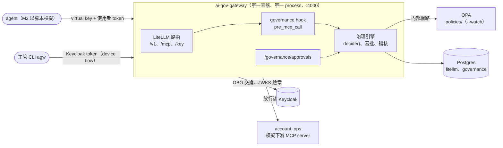
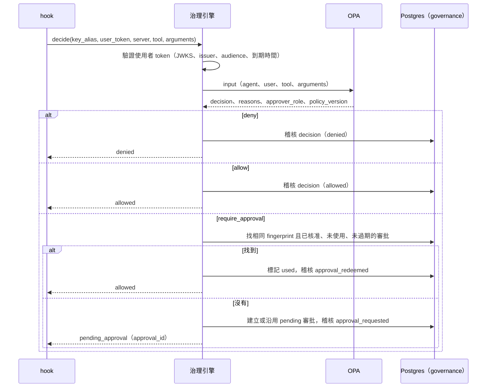

# M2 治理服務設計

## 1. 目標與範圍

在 ai-gov-gateway 上實作 tool 呼叫的治理：agent 註冊與版本控管、OPA policy 判斷、maker-checker 審批、防竄改稽核 log。M2 以腳本模擬 agent 驗證完整流程，kyt_agent 接入屬於 M3。

M1 的結論（`docs/spikes/m1-findings.md`）決定了 M2 的基礎：

| 結論 | 對 M2 的影響 |
| ---- | ------------ |
| 上游 MCP server 看不到 agent 身份（V6） | 治理執行點放在 LiteLLM 的 `pre_mcp_call` hook |
| hook 拿得到 `key_alias`、`incoming_bearer_token`、`mcp_tool_name`、`mcp_arguments`（V7） | 引擎的輸入直接來自 hook |
| OBO、依 key 的 tool 權限、tool 鎖定在開源版可用（V4、V8） | 不自建這些功能 |
| Keycloak delegation 屬於 preview 且無法搭配 LiteLLM OBO（V5） | agent 身份由 virtual key 取得，寫入稽核 |

### 範圍內

- 單一 gateway 服務：LiteLLM 與治理邏輯在同一個 process、同一個 port
- agent 註冊表與「一個核准版本一把 virtual key」
- OPA policy 與資料（中央治理團隊以 GitOps 維護）
- 審批 API、審批 CLI（`agw`）
- 稽核 log（hash chain）與驗證指令
- 模擬下游 `account_ops`（`add_to_watchlist`、`freeze_account`、`file_str`）
- 端到端示範腳本

### 不在範圍內

- kyt_agent 接入（M3）
- 記錄下游執行結果（post-call hook）
- Shadow AI 與敏感資料偵測、依 agent 分帳的儀表板、依角色顯示的前端
- OPA bundle server（M2 以 `--watch` 讀取掛載的目錄）
- `list_mcp_tools` 的治理（tool 可見性維持由 LiteLLM 依 key 決定）

## 2. 已確定的決策

| 項目 | 決策 | 理由 |
| ---- | ---- | ---- |
| 部署形式 | 自建映像：LiteLLM v1.105.1 加上 `ai_gov_gateway` 套件，進入點把 `/governance` router 加進 LiteLLM 的 `app` | 統一的 gateway 服務；已實測可行，只依賴 `litellm.proxy.proxy_server.app` 與 `CONFIG_FILE_PATH` |
| 引擎呼叫方式 | hook 在 process 內直接呼叫引擎函式 | 沒有網路往返，不需處理服務間的失敗 |
| 外部依賴 | Postgres（資料）、Keycloak（模擬公司的 IdP）、OPA（policy） | gateway 是 relying party，不管理帳號；換成 Entra / Okta 只改 issuer 設定 |
| OPA 部署 | docker compose 的獨立服務，不對外開 port；部署到 Kubernetes 時改為 sidecar | policy 與程式分開管理與測試 |
| Policy 管理 | `policies/` 目錄，OPA `--watch` 載入；變更經 PR 與 `opa test` | 中央治理團隊以 GitOps 管理 |
| 兌現核准 | agent 以相同參數重送，gateway 以 fingerprint 比對已核准、未使用、未過期的審批 | tool schema 不變；核准綁定參數、只能使用一次 |
| 審批等待 | 非同步：回傳 `pending_approval` 與 approval_id | 主管可能數小時後才處理 |
| agent 版本 | virtual key 命名為 `<agent>@<版本>`，一個核准版本一把 key | gateway 拿不到 agent 的設定檔，版本只能綁在 gateway 簽發的憑證上 |
| 儲存 | 沿用 Postgres，另開 `governance` 資料庫 | gateway 可能有多個 worker |
| 失敗處理 | 一律 fail-closed | 無法判斷或無法稽核時不得執行 |

## 3. 架構



### 元件

| 元件 | 職責 | 位置 |
| ---- | ---- | ---- |
| gateway 進入點 | import LiteLLM 的 `app`，`include_router(governance_router)` | `src/ai_gov_gateway/app.py` |
| governance hook | 從 LiteLLM `data` 取出 agent、使用者 token、tool、參數，呼叫引擎；放行時回傳 `data`，否則 raise JSON 訊息 | `src/ai_gov_gateway/hook.py` |
| 治理引擎 | token 驗證、組成 OPA input、處理審批比對、寫入稽核 | `src/ai_gov_gateway/engine/` |
| 審批 API | 列表、詳情、核准、駁回；maker-checker | `src/ai_gov_gateway/api/` |
| 審批 CLI | `agw login`、`agw approvals …`、`agw audit verify` | `src/ai_gov_gateway/cli.py` |
| 設定 | pydantic-settings：OPA URL、資料庫、Keycloak issuer 與 JWKS、審批有效期 | `src/ai_gov_gateway/config.py` |
| Policy 與資料 | 規則、agent 註冊表、tool 註冊表、制裁名單、版本 | `policies/` |
| account_ops | 三個 tool 與記憶體內的帳戶狀態 | `account_ops/` |

依賴方向：`app` → `hook` / `api` → `engine` → `config`。`engine` 不 import LiteLLM，可以不啟動 LiteLLM 單獨測試。引擎依賴兩個 Protocol：`PolicyClient`（OPA）與 `GovernanceStore`（Postgres）。

M1 的 `probe_mcp` 保留於 compose，登記為 low 風險 tool，作為升級 LiteLLM 時的回歸測試；`scripts/` 的 M1 驗證腳本保留作為紀錄。

### 映像

```dockerfile
FROM docker.io/litellm/litellm:v1.105.1
COPY . /opt/ai-gov-gateway
RUN uv pip install --python /app/.venv/bin/python /opt/ai-gov-gateway
ENV CONFIG_FILE_PATH=/app/config.yaml
CMD ["/app/.venv/bin/python", "-m", "uvicorn", "ai_gov_gateway.app:app", "--host", "0.0.0.0", "--port", "4000"]
```

套件裝進 LiteLLM 的 venv（Python 3.13），相依套件需與 LiteLLM 的版本相容（見 §9 風險）。`litellm/config.yaml` 的 guardrail 改為 `guardrail: ai_gov_gateway.hook.GovernanceHook`。

## 4. 決策流程



- **每次都先問 OPA**，再查核准紀錄。agent 在核准後被停用時，OPA 回 deny，核准無法兌現
- **fingerprint** = `sha256(agent_id, agent_version, user_sub, server, tool, canonical(arguments))`；`canonical` 為 key 排序、無多餘空白的 JSON
- 相同 fingerprint 已有 pending 審批時沿用，不重複建立
- 審批有效期預設 24 小時（`APPROVAL_TTL_HOURS`）；核准只能使用一次
- 駁回後以相同參數重送，建立新的 pending 審批（主管可看到歷史）
- `key_alias` 依 `<agent>@<版本>` 解析；不符合格式視為未註冊

### 回傳給 agent 的訊息

放行時 hook 回傳 `data`，LiteLLM 繼續 OBO 與轉送。其他情況 raise，訊息為 JSON 字串，原樣出現在 client 的 tool result（`isError=True`）：

```json
{"governance": "pending_approval", "approval_id": "apr_…", "reasons": ["amount_over_threshold"], "expires_at": "2026-10-21T10:00:00Z"}
{"governance": "denied", "reasons": ["role_required"]}
```

## 5. OPA policy

### input

```json
{
  "agent": { "id": "kyt-agent", "version": "1.4", "key_alias": "kyt-agent@1.4" },
  "user": { "sub": "9747e12d-…", "username": "alice", "roles": ["analyst"] },
  "tool": { "server": "account_ops", "name": "freeze_account" },
  "arguments": { "account_id": "acct-001", "amount_usd": 25000, "counterparty": "0x…", "reason": "…" }
}
```

### 資料（`policies/data/`）

| 檔案 | 內容 |
| ---- | ---- |
| `agents.json` | 每個 agent：`owner`、`status`（`active` / `suspended`）、`max_risk`、`versions`（版本 → `key_alias`、`approved_by`、`approved_at`） |
| `tools.json` | 每個 `<server>.<tool>`：`risk`（`low` / `high`）與門檻（`freeze_account` 的 `amount_threshold_usd: 10000`） |
| `sanctions.json` | 範例制裁地址清單（小寫） |
| `meta.json` | `policy_version`；每次修改 `policies/` 都要更新 |

### 規則

依序判斷，任一 deny 即結束：

| # | 條件 | 結果與原因 |
| - | ---- | ---------- |
| 1 | `key_alias` 不在註冊表的任何版本中 | deny：`unregistered_agent_version` |
| 2 | agent `status` 不是 `active` | deny：`agent_suspended` |
| 3 | `<server>.<tool>` 不在 `tools.json` | deny：`unknown_tool` |
| 4 | tool 的 `risk` 高於 agent 的 `max_risk` | deny：`risk_exceeds_agent_limit` |
| 5 | `account_ops` 的 tool，使用者沒有 `analyst` 角色 | deny：`role_required` |
| 6 | `add_to_watchlist` | allow |
| 7 | `freeze_account`，`counterparty` 在制裁名單 | require_approval：`sanctioned_counterparty` |
| 8 | `freeze_account`，`amount_usd` ≥ 門檻 | require_approval：`amount_over_threshold` |
| 9 | `freeze_account` 其他情況 | allow |
| 10 | `file_str` | require_approval：`str_always_reviewed` |
| — | 其他 low 風險 tool（如 `probe.whoami`） | allow |

規則 7、8 同時成立時兩個原因都列出。require_approval 附帶 `approver_role: compliance_supervisor`。決策結果一律附帶 `policy_version`。

maker-checker（核准者不得為委託人）由審批 API 在核准時檢查，不在 OPA 中，因為核准者只在核准當下才知道。

查詢端點：`POST http://opa:8181/v1/data/governance/decision`，逾時 2 秒。

## 6. 審批

### API

| 方法與路徑 | 用途 | 權限 |
| ---------- | ---- | ---- |
| `GET /governance/approvals?status=pending` | 列出審批 | `compliance_supervisor` |
| `GET /governance/approvals/{id}` | 詳情：agent、版本、委託人、tool、參數、原因、到期時間、歷史 | `compliance_supervisor` |
| `POST /governance/approvals/{id}/approve` | 核准，body `{"comment": "…"}` | `compliance_supervisor`，且 `sub` ≠ 委託人 |
| `POST /governance/approvals/{id}/reject` | 駁回，body `{"comment": "…"}` | `compliance_supervisor` |

- 驗證 Keycloak access token（JWKS 驗章、issuer、audience 含 `ai-gateway`、到期時間）；不使用 LiteLLM virtual key
- 核准者為委託人本人：`403 self_approval_forbidden`；角色不符：`403 role_required`；狀態不是 pending：`409`
- 狀態轉換：`pending → approved | rejected | expired`、`approved → used | expired`；過期在讀取或比對時判斷並寫入稽核

### CLI

```bash
uv run agw login                      # Keycloak device flow（client agw-cli）
uv run agw approvals list
uv run agw approvals show <id>
uv run agw approvals approve <id> --comment "…"
uv run agw approvals reject <id> --comment "…"
uv run agw audit verify
```

- Keycloak 新增 public client `agw-cli`（device flow），audience mapper 指向 `ai-gateway`
- token 存於 `~/.config/ai-gov-gateway/token.json`（權限 0600），只存 access token，過期重新登入
- 輸出不顯示 token 原文

## 7. 稽核 log

`governance.audit_events`，只追加：

| 欄位 | 說明 |
| ---- | ---- |
| `id`、`ts` | 遞增 ID、時間（UTC） |
| `event_type` | `decision`、`approval_requested`、`approval_redeemed`、`approval_approved`、`approval_rejected`、`approval_expired` |
| `agent_id`、`agent_version`、`key_alias` | agent 與版本 |
| `user_sub`、`username` | 委託人 |
| `actor_sub`、`actor_username` | 核准或駁回者（審批事件） |
| `server`、`tool`、`arguments` | 呼叫內容（`arguments` 為 jsonb） |
| `decision`、`reasons`、`approval_id` | 決策 |
| `policy_version` | 做出判斷的 policy 版本 |
| `prev_hash`、`hash` | `hash = sha256(prev_hash + canonical(事件內容))`；第一筆的 `prev_hash` 為 64 個 0 |

- 寫入時在 transaction 中以 `pg_advisory_xact_lock` 序列化，確保多個 worker 寫入時 hash chain 仍為單一序列
- 稽核寫入失敗時拒絕（`audit_write_failed`）
- `agw audit verify` 重算整條 chain，回報第一筆不一致的 `id`
- 資料表與審批表在 gateway 啟動時以 `CREATE TABLE IF NOT EXISTS` 建立

`governance.approvals`：`id`、`fingerprint`、`status`、`agent_id`、`agent_version`、`key_alias`、`user_sub`、`username`、`server`、`tool`、`arguments`、`reasons`、`approver_role`、`created_at`、`expires_at`、`decided_by`、`decided_at`、`comment`、`used_at`。

## 8. 錯誤處理

一律 fail-closed：

| 情況 | 結果 | 原因代碼 |
| ---- | ---- | -------- |
| 沒有使用者 token | deny | `missing_user_token` |
| token 無效、過期或 audience 不符 | deny | `invalid_user_token` |
| OPA 連不上或逾時 | deny | `policy_unavailable` |
| OPA 回傳格式不正確 | deny | `policy_error` |
| Postgres 連不上 | deny | `governance_store_unavailable` |
| 稽核寫入失敗 | deny | `audit_write_failed` |
| hook 內部預期外的例外 | deny | `governance_internal_error` |

### 已知限制

- 只記錄決策，不記錄下游執行結果
- 核准在放行當下標記為 used；下游執行失敗時需重新申請
- `list_mcp_tools` 不經治理；未註冊版本的 key 仍可能看到 tool，但呼叫時會被拒絕

## 9. 測試

| 層級 | 範圍 | 需要 Docker | 指令 |
| ---- | ---- | ----------- | ---- |
| 單元 | 引擎、審批狀態機、fingerprint、token 驗證、hash chain、hook 轉接、API（FastAPI TestClient） | 否 | `uv run pytest` |
| Policy | 規則 1–10、low 風險預設、`meta.json` | 否（OPA CLI） | `opa test policies/` |
| 整合 | 端到端情境、LiteLLM 契約 | 是 | `uv run pytest -m integration` |

- 引擎以 fake `PolicyClient` 與 fake `GovernanceStore` 測試；Postgres 實作另有整合測試
- token 驗證：測試中產生 RSA 金鑰與 JWKS，簽出合法、過期、audience 錯誤、簽章錯誤的 token
- hook 轉接：以 M1 V7 實際看到的 `data` 結構作為測試資料
- LiteLLM 契約：`app` 可 import 並加上 router 啟動；hook 的 `data` 含 `mcp_tool_name`、`mcp_arguments`、`incoming_bearer_token`；raise 訊息原樣出現在 tool result

### 端到端完成標準

| # | 情境 | 預期 |
| - | ---- | ---- |
| 1 | alice 經 `kyt-agent@1.4` 呼叫 `add_to_watchlist` | allowed |
| 2 | `freeze_account` 金額 5,000 | allowed |
| 3 | `freeze_account` 金額 25,000 | pending → bob 核准 → 相同參數重送 allowed → 第三次又 pending |
| 4 | 情境 3 由 alice 自己核准 | `403 self_approval_forbidden` |
| 5 | 核准後修改金額重送 | 新的 pending |
| 6 | `freeze_account` 涉及制裁地址、金額小 | pending：`sanctioned_counterparty` |
| 7 | `file_str` | pending：`str_always_reviewed` |
| 8 | 以未註冊的 `kyt-agent@1.5` key 呼叫 | denied：`unregistered_agent_version` |
| 9 | 核准後將 agent 設為 suspended 再重送 | denied：`agent_suspended` |
| 10 | 以 bob（無 analyst 角色）為委託人呼叫 | denied：`role_required` |
| 11 | 停止 OPA 後呼叫 | denied：`policy_unavailable` |
| 12 | bob 駁回後重送 | 新的 pending，詳情含先前的駁回紀錄 |
| 13 | `agw audit verify`；直接竄改一筆後再驗證 | 先通過；竄改後失敗並指出 `id` |

`scripts/demo_m2.py` 依序執行上述情境並輸出每一步結果。

M1 腳本的回歸：
- M1 的 key `kyt-agent-mcp` 不符合 `<agent>@<版本>` 命名，M2 起會被拒絕（`unregistered_agent_version`）；`scripts/make_keys.py` 改為建立 `kyt-agent@1.4`，`call_whoami.py` 的預設 key 一併更改
- `call_whoami.py`（`probe.whoami` 登記為 low）須通過，V4 的 OBO 結果不變
- `call_echo.py` 的「含 freeze 即阻擋」是 M1 hook 寫死的驗證規則，M2 移除；`probe.echo` 登記為 low 後放行。依參數值阻擋改由情境 3、6 驗證

### 其他完成條件

- `ruff`、`mypy src` 無錯誤；單元測試與 `opa test` 全部通過
- README、`AGENTS.md` 更新架構、啟動方式、審批操作與 M2 狀態
- 更新 `docs/ai-gov-gateway/` 的學習文件

## 10. 風險

| 風險 | 處理 |
| ---- | ---- |
| 套件相依與 LiteLLM venv 衝突 | 只使用 LiteLLM 已帶的套件或常見套件（httpx、pydantic、FastAPI 由 LiteLLM 提供）；新增的 `PyJWT[crypto]`、`psycopg` 在建置映像時確認版本相容 |
| LiteLLM 升級改變 hook 介面或 `app` | 固定 v1.105.1；契約測試為升級前的必要檢查 |
| hook 的 raise 訊息格式在不同 client 呈現不同 | 以 MCP Python SDK client 驗證；訊息為純 JSON 字串，不依賴例外型別 |
| device flow 無法在自動化測試中執行 | 自動化測試沿用 password grant 測試帳號，device flow 以手動驗證 |
| 多 worker 同時寫入稽核 | advisory lock 序列化；整合測試以並行請求驗證 chain 完整 |

## 11. 撰寫實作計畫時的修正（2026-10-20）

計畫前實測後，以下細節與上文不同，以本節為準：

| 項目 | 上文 | 修正 | 理由 |
| ---- | ---- | ---- | ---- |
| 啟動方式 | 自訂 uvicorn 進入點 `app.py` | 保留 `litellm --config` 啟動；LiteLLM 依 guardrail 設定載入 `ai_gov_gateway.plugin` 時，該模組把 `/governance` router 掛到 app | LiteLLM CLI 在啟動前會做 Prisma migration 與環境設定，自訂進入點會略過 |
| 映像 | `uv pip install` 套件 | 複製 `src/ai_gov_gateway` 並設定 `PYTHONPATH` | 映像內沒有 pip 與 uv；執行期相依已在 LiteLLM 的 venv |
| `mcp` 相依 | 未說明 | 只放在 `scripts` 依賴群組（`mcp<2`），不列入套件相依 | LiteLLM venv 內是 mcp 2.2.0 |
| Policy 資料位置 | `policies/data/agents.json` 等 | `policies/agents/data.json`、`policies/tools/data.json`、`policies/sanctions/data.json`、`policies/meta/data.json` | OPA 以 `<dir>/data.json` 對應 `data.<dir>` |
| 規則 | 規則 1–10 | 另加 `amount_missing`、`counterparty_missing`（凍結參數缺漏時送審）與 `high_risk_unreviewed_tool`（新增的高風險 tool 未寫規則時送審） | 參數缺漏時 Rego 的 `not` 會得到 undefined 而 fail-open；新 tool 預設送審 |
| 稽核欄位 | §7 | 新增 `comment` | 核准與駁回的意見需可追溯 |
| 稽核驗證 | `agw audit verify` 直接讀資料庫 | 經 `GET /governance/audit/verify`（`compliance_supervisor`） | CLI 不需資料庫憑證 |
| 寫入一致性 | 未說明 | 審批狀態變更與對應的稽核事件在同一個 transaction 寫入 | 避免「狀態變了但沒有稽核」 |
| account_ops 的 tool 鎖定 | 未說明 | M2 不設定 | 不在 M2 驗收情境中 |
| Postgres port | 未對外 | 開 `127.0.0.1:5433` | 主機上的整合測試需要連線 |
| 情境 4 | alice 自己核准 | 新增測試帳號 carol（analyst + compliance_supervisor），由 carol 委託後自己核准 | alice 沒有主管角色，只會得到 `role_required`，測不到 maker-checker |
